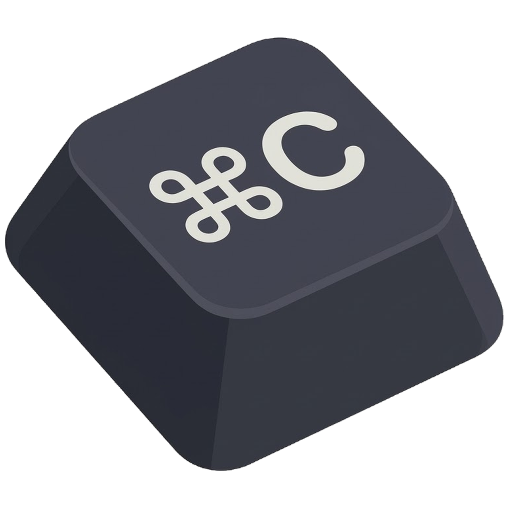
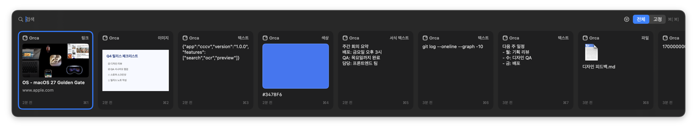
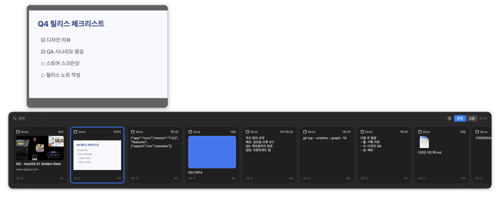
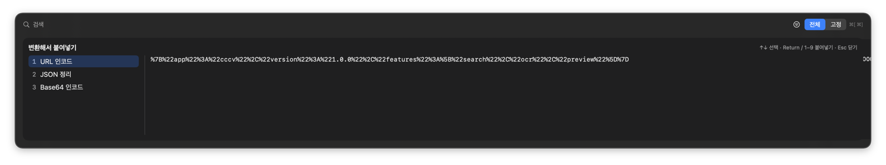
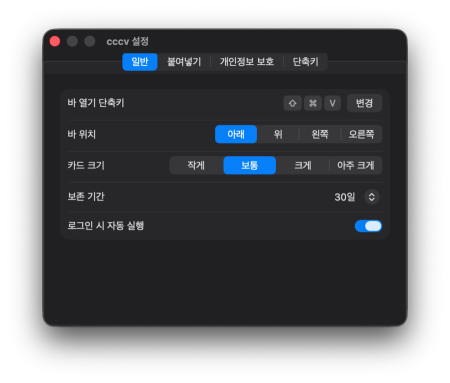
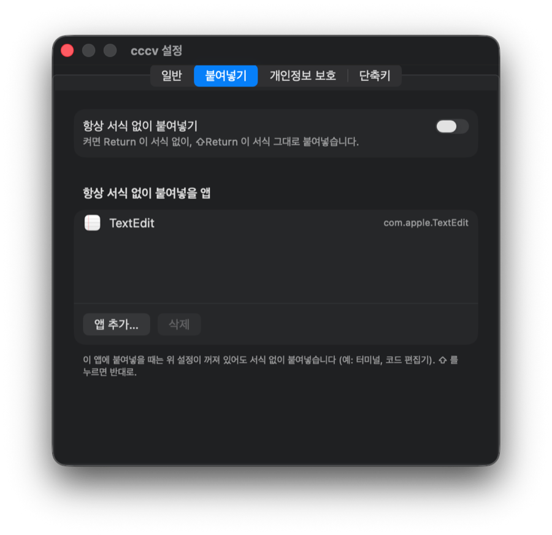
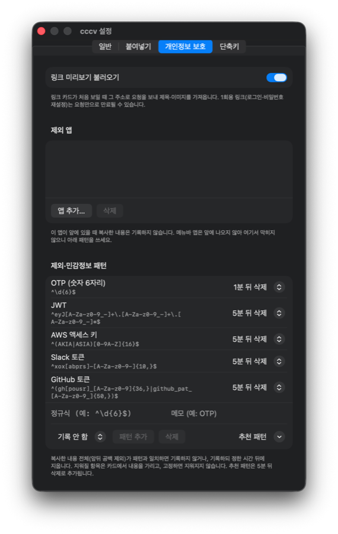

<p align="center">
  
</p>

<h1 align="center">CCCV</h1>

<p align="center"><b>C</b>ommand + <b>C</b>, <b>C</b>ommand + <b>V</b></p>

<p align="center">⌘C 한 것들을 다시 꺼내 쓰는 macOS 클립보드 매니저</p>

---

복사한 텍스트·이미지·파일·링크·색상을 기록해 두고, <kbd>⇧</kbd><kbd>⌘</kbd><kbd>V</kbd> 로 바를 열어 골라 붙여넣습니다.

<p align="center"></p>

## 주요 기능

- **기록** — 텍스트, 서식 텍스트, 이미지, 파일, 링크, 색상(`#RRGGBB`). 같은 내용을 다시 복사하면 하나로 합쳐 맨 앞으로.
- **바** — 커서가 있는 화면의 아래·위·왼쪽·오른쪽 가장자리. 카드 크기 4단계.
- **검색·필터** — 본문, 이름, 링크 제목, **이미지 속 글자(OCR)** 까지 검색. 종류·출처 앱 필터, 고정 항목만 보기.
- **붙여넣기** — 커서 위치에 바로. 서식 없이 붙여넣기, 앱별로 항상 서식 없이(터미널·코드 편집기 등).
- **미리보기** — <kbd>Space</kbd> 로 선택한 카드 옆에 크게.
- **개발자 변환** — <kbd>⌘</kbd><kbd>T</kbd> 로 URL·JSON·Base64·JWT·타임스탬프·camel/snake/kebab 변환해서 붙여넣기.
- **정리** — 고정(보존 기간에서 제외), 이름 붙이기, 내용 편집, 삭제·되돌리기.
- **개인정보** — 비밀번호 관리자 항목은 기록 안 함, 제외 앱, 정규식 패턴으로 기록 안 함 또는 N분 뒤 자동 삭제(토큰 등), 일시정지.
- **링크 미리보기** — 링크 카드에 페이지 제목·대표 이미지.

<p align="center"></p>
<p align="center"><sub>Space — 선택한 카드 옆에 크게 미리보기</sub></p>

<p align="center"></p>
<p align="center"><sub>⌘T — 변환 목록과 결과 미리보기</sub></p>

## 설치 (공유받은 zip)

> Apple Silicon(M 시리즈) Mac, **macOS 26 이상**에서 실행됩니다.

CCCV 는 유료 Apple Developer Program 으로 서명하거나 공증(notarization)하지 않습니다. 다운로드한 앱을 처음 실행하면 Gatekeeper 가 "확인되지 않은 개발자"라고 경고합니다. 출처를 확인했다면 다음 중 하나로 열 수 있습니다.

- Finder 에서 `CCCV.app` 을 우클릭 → **열기** → 대화상자에서 다시 **열기**
- 시스템 설정 → 개인정보 보호 및 보안 → **그래도 열기**

가능하면 받은 zip 대신 아래 [직접 빌드](#직접-빌드)로 이 Mac 에서 만드는 쪽을 권합니다.

1. `cccv.zip` 을 받아 압축을 풉니다 (보통 `다운로드/cccv` 폴더가 생깁니다).
2. 터미널을 열고 아래 한 줄을 실행합니다.
   ```sh
   bash ~/Downloads/cccv/install.sh
   ```
   응용 프로그램 폴더에 설치하고 실행합니다. 업데이트할 때도 새 zip 을 풀고 같은 명령을 실행하면 됩니다.
3. **손쉬운 사용 권한**을 허용합니다 (시스템 설정 → 개인정보 보호 및 보안 → 손쉬운 사용 → CCCV). 허용한 뒤 CCCV 를 한 번 종료했다 다시 엽니다.
   이 권한이 있어야 고른 항목이 커서 위치에 바로 붙여넣어집니다. 없으면 클립보드에 복사만 됩니다.
   새 버전으로 업데이트하면 서명이 바뀌어 이 권한이 풀립니다. 붙여넣기가 안 되고 클립보드에 복사만 되면, 시스템 설정 → 개인정보 보호 및 보안 → 손쉬운 사용에서 − 버튼으로 CCCV 를 지운 뒤 다시 추가하거나 스위치를 껐다 켜세요. 그다음 메뉴바 ⌘C 아이콘 → 종료 → 응용 프로그램에서 CCCV 를 다시 엽니다.

> **경고:** `install.sh` 는 설치한 `CCCV.app` 의 격리 표시(`com.apple.quarantine`)를 `xattr -dr` 로 지웁니다. 이 표시를 지우면 Gatekeeper 검사를 우회합니다. 직접 빌드했거나, 내용을 믿는 빌드에만 실행하세요.

## 사용법

<kbd>⇧</kbd><kbd>⌘</kbd><kbd>V</kbd> 로 바를 열고, 바로 입력하면 검색됩니다.

| 키 | 동작 |
|---|---|
| <kbd>←</kbd> <kbd>→</kbd> (세로 바 <kbd>↑</kbd> <kbd>↓</kbd>) | 항목 이동 |
| <kbd>Return</kbd> / <kbd>⇧</kbd><kbd>Return</kbd> | 붙여넣기 / 서식 반대로 붙여넣기 |
| <kbd>⌘</kbd><kbd>1</kbd>–<kbd>9</kbd> | 앞에서 N번째 바로 붙여넣기 |
| <kbd>Space</kbd> / <kbd>⌘</kbd><kbd>Y</kbd> | 크게 미리보기 (검색 중엔 방향키로 고른 뒤 Space, 또는 ⌘Y) |
| <kbd>⌘</kbd><kbd>[</kbd> <kbd>⌘</kbd><kbd>]</kbd> | 전체 / 고정 전환 |
| <kbd>⌘</kbd><kbd>P</kbd> · <kbd>⌘</kbd><kbd>R</kbd> · <kbd>⌘</kbd><kbd>E</kbd> | 고정 · 이름 변경 · 내용 편집 |
| <kbd>⌘</kbd><kbd>T</kbd> | 변환해서 붙여넣기 |
| <kbd>⌫</kbd> / <kbd>⌘</kbd><kbd>Z</kbd> | 삭제 / 되돌리기 (검색어가 비어 있을 때) |
| <kbd>Esc</kbd> | 검색어 지우기 → 바 닫기 |

카드를 우클릭해도 같은 동작을 고를 수 있습니다. 바 열기 단축키, 바 위치, 카드 크기, 보존 기간(기본 30일), 로그인 시 자동 실행 등은 메뉴바 ⌘C 아이콘 → **설정…** 에서 바꿉니다.

<p align="center">
  
  
  
</p>

## 개인정보

- 기록은 이 Mac 의 `~/Library/Application Support/cccv/` 에 SwiftData(`cccv.store`)로 저장됩니다. 앱이 암호화하지 않습니다. 기록을 서버로 보내지 않고, 사용 통계를 수집하는 코드도 없습니다.
- 보존 기간 기본값은 30일입니다. 고정한 항목은 기간이 지나도 지우지 않습니다.
- 이미지 속 글자(OCR)는 Apple Vision 으로 이 Mac 에서만 인식합니다 (한국어·영어). 이미지를 밖으로 보내지 않습니다.
- 손쉬운 사용 권한은 고른 항목을 커서 위치에 붙여넣으려고 ⌘V 키 입력을 만들 때만 씁니다. 권한이 없으면 클립보드에 올리기만 합니다.
- 네트워크 요청은 **링크 미리보기**뿐입니다. 링크 카드가 처음 보일 때 `LPMetadataProvider` 가 그 주소로 제목·대표 이미지를 가져옵니다. 기본값은 켜짐이고, 설정 → 개인정보 보호 → **링크 미리보기 불러오기** 에서 끌 수 있습니다. 1회용 링크(로그인·비밀번호 재설정)는 요청만으로 만료될 수 있습니다.
- 비밀번호 관리자 등이 붙이는 `org.nspasteboard.ConcealedType`, `org.nspasteboard.TransientType` 이 있는 클립보드는 기록하지 않습니다.
- 미리보기가 임시 파일을 만들면 `$TMPDIR/cccv-preview` 아래에 둡니다. 미리보기를 닫거나 다른 항목으로 바꾸면 지웁니다.
- 메뉴바 앱(OTP 앱 등)에서 복사한 내용은 출처 앱을 알 수 없어 "제외 앱" 으로 막히지 않습니다. 정규식 패턴(기본: 숫자 6자리)으로 막으세요.

## 직접 빌드

macOS 26, Xcode 26 (Swift 6.2) 이 필요합니다.

```sh
swift test               # 핵심 로직 테스트
./scripts/bundle.sh      # 빌드 → 서명 → /Applications/CCCV.app 설치
./scripts/package.sh     # 공유용 dist/cccv.zip (CCCV.app + install.sh)
```

- 서명: 기본은 ad-hoc(`codesign -s -`)입니다. 키체인 인증서를 찾지 않으므로, 인증서가 없는 Mac 에서도 빌드되고 바이너리에 개인 이름이나 Team ID 가 들어가지 않습니다. Apple Developer Program(유료)은 필요 없습니다. ad-hoc 서명은 빌드할 때마다 바뀌어, 손쉬운 사용 권한을 다시 허용해야 합니다. 같은 개발자 인증서로 서명해 권한을 유지하려면 `CODESIGN_IDENTITY` 에 인증서 이름이나 SHA-1 을 넣어 실행하세요.
- 구조: `Sources/CCCVCore` (저장소·분류·변환 등 테스트 가능한 로직), `Sources/cccv` (AppKit·SwiftUI 앱).

## 라이선스

MIT. [LICENSE](LICENSE) 를 보세요.
